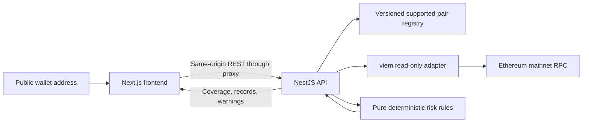

# Wallet Permission Scanner

**Status: Planning.** A planned read-only Web3 security application for inspecting supported ERC-20 permissions on Ethereum mainnet. This repository currently contains planning documentation and project-local Codex skills; application functionality, scripts, containers, and CI are not implemented.

## Problem

Token allowances can remain active after a user stops using an application. Users need a way to inspect the spending permissions they have granted, understand their size, and inspect the relevant contracts. A public wallet address is sufficient for the planned inspection; connecting a wallet is unnecessary.

Coverage is a central constraint: a standard Ethereum RPC connection cannot enumerate all token allowances belonging to an address. The MVP will inspect an explicitly maintained set of token/spender pairs. A successful scan will mean that the configured set was checked, **not that every approval was discovered**. See the [blockchain strategy](docs/architecture/blockchain-integration.md).

## Goals

- Demonstrate Ethereum contract reads, blockchain data processing, and exact integer handling.
- Build a typed NestJS API and integrate it with a Next.js frontend.
- Explain permission heuristics and incomplete results without claiming to audit contracts.
- Provide deterministic tests, failure handling, and a reproducible public demonstration.
- Keep the scope achievable for one developer and make engineering trade-offs reviewable.

## Planned MVP features

- Validate a public Ethereum address, including checksum handling.
- Inspect configured ERC-20 token/spender pairs on mainnet, at one finalized block per scan.
- Read current allowance, token balance, and available token metadata.
- Identify active, inactive, and unreadable permissions separately.
- Flag the maximum uint256 allowance, large allowances relative to balance, and other documented signals.
- Return transparent, versioned heuristic classifications and spender identity provenance.
- Filter and sort results locally, and follow trusted blockchain explorer links.
- Handle loading, empty, partial, rate-limited, and failed scans.
- Offer an explicitly labeled deterministic demo separate from live blockchain results.

The MVP will not connect wallets, request signatures, execute transactions, revoke permissions, inspect NFTs, resolve ENS names, calculate fiat exposure, or promise comprehensive approval discovery. Owner-supplied Refero materials now live in [docs/design](docs/design/DESIGN.md) and guide later visual implementation.

## Network support

Ethereum mainnet, chain ID `1`, is the only planned live network. Test doubles and demo fixtures will simulate responses without making claims about live state. Other networks are post-MVP work.

## Planned technology stack

| Area | Choice | Purpose |
| --- | --- | --- |
| Frontend | Next.js App Router, React, TypeScript | Application and typed API integration |
| Interface tooling | Tailwind CSS, shadcn/ui, Lucide Icons | Reserved for later implementation using supplied visual references |
| Backend | NestJS, Node.js, TypeScript, REST | Validation, scan orchestration, risk analysis, operational controls |
| Ethereum | viem public client | Read-only RPC and contract calls |
| Contracts package | Zod schemas and inferred TypeScript types | Shared HTTP validation and serialization contract |
| Monorepo | pnpm workspaces | Two applications and small shared packages |
| Infrastructure | Docker, Docker Compose, GitHub Actions | Local services, reproducible builds, CI |
| Optional persistence | PostgreSQL with Prisma ORM | Deferred until cached results or history have a justified requirement |

Select supported stable versions and a compatible Node.js LTS release when implementation begins; record and lock the choices then. No versions or dependency installations are implied by this planning repository.

## High-level architecture



The backend owns blockchain access, bounded work, normalization, and risk rules. The browser receives decimal strings for token amounts and never receives an RPC credential. PostgreSQL is not required for the initial scan path. See the [architecture overview](docs/architecture/overview.md), [API contract](docs/architecture/api-design.md), and [architecture decision](docs/architecture/decisions/ADR-001-architecture.md).

## Planned application workflow

1. Load the published supported-pair coverage and its limitations.
2. Accept and validate a wallet address; submit `POST /api/v1/scans`.
3. Validate mainnet connectivity, obtain a recent finalized block, and inspect the configured pairs at that block.
4. Normalize successful and failed reads; classify readable permissions using `mvp-1` rules.
5. Return snapshot details, complete or partial status, records, and explicit warnings.
6. Let users inspect, filter, sort, and follow explorer links. A complete scan with no active permissions only describes the supported set.

## Security considerations

All planned chain operations are reads. There will be no private keys, seed phrases, wallet signing, fund custody, or transaction submission. Risk labels indicate heuristic permission exposure; they are not evidence that a spender is malicious or safe. Even a zero balance can leave an allowance relevant to future deposits.

The API will validate input, restrict work to its registry, enforce rate and concurrency limits, bound RPC requests, avoid caching wallet responses in browsers or proxies, and redact sensitive logs. Wallet addresses are public blockchain identifiers but scan activity can still expose user interests. RPC providers and explorer sites have their own privacy implications. See the [security specification](docs/architecture/security.md).

## Codex project context

The root [AGENTS.md](AGENTS.md) defines the reading order and persistent project instructions for Codex. Before frontend work it requires explicitly reading the owner's [design reference](docs/design/DESIGN.md), [structured tokens](docs/design/tokens.json), [CSS variables](docs/design/variables.css), and [Tailwind theme export](docs/design/theme.css). These files are supplied references, not implemented application styles.

The design pack is now present. It does not select Base as a supported blockchain or add the reference site's copy/features to this product. Stage 04 must reconcile any relevant extraction conflicts before applying them. Backend contracts, read-only safety constraints, and the current task scope remain authoritative.

Codex discovers project `AGENTS.md` instructions when it starts a run; a linked design directory still needs to be read explicitly. Start a fresh Codex run from this project if an existing session has not loaded the new guidance. See the [official OpenAI instructions documentation](https://learn.chatgpt.com/docs/agent-configuration/agents-md).

## Repository structure

The existing project files include documentation and local skills:

```text
README.md
AGENTS.md
skills.md
.agents/skills/                       # Project-local Codex instructions and resources
docs/
├── architecture/
│   ├── overview.md
│   ├── project-structure.md
│   ├── blockchain-integration.md
│   ├── data-model.md
│   ├── api-design.md
│   ├── security.md
│   └── decisions/ADR-001-architecture.md
├── design/                           # Owner-supplied Refero reference pack
│   ├── DESIGN.md
│   ├── tokens.json
│   ├── variables.css
│   └── theme.css
└── features/
    ├── ROADMAP.md
    └── stages/
        ├── 01-project-foundation.md
        ├── 02-blockchain-integration.md
        ├── 03-backend-and-risk-analysis.md
        ├── 04-frontend-integration.md
        ├── 05-testing-and-security.md
        └── 06-deployment-and-release.md
```

The proposed application directories, which do not exist yet, are `apps/web`, `apps/api`, `packages/contracts`, `packages/typescript-config`, and `infra`. Their responsibilities are specified in [project structure](docs/architecture/project-structure.md).

## Development roadmap

| Stage | Deliverable | Status |
| --- | --- | --- |
| [01 — Foundation](docs/features/stages/01-project-foundation.md) | Workspace, application shells, configuration, health checks, local Compose | Planned |
| [02 — Blockchain](docs/features/stages/02-blockchain-integration.md) | Registry, validated mainnet reads, bounded failure handling | Planned |
| [03 — API and risk](docs/features/stages/03-backend-and-risk-analysis.md) | Scan contract, deterministic classification, operational controls | Planned |
| [04 — Frontend](docs/features/stages/04-frontend-integration.md) | Functional integration using the supplied docs/design reference pack | Planned |
| [05 — Testing and security](docs/features/stages/05-testing-and-security.md) | Cross-layer verification, failure scenarios, security review | Planned |
| [06 — Release](docs/features/stages/06-deployment-and-release.md) | Production images, hardened CI, deployment runbook, deterministic demo | Planned |

Use the [roadmap](docs/features/ROADMAP.md) for stage gates and progress. Tests are added with each stage; Stage 05 expands and reviews them rather than postponing all verification.

## Local development prerequisites

Implementation will require Git, a compatible supported Node.js LTS release, the selected pinned pnpm version, Docker Engine/Desktop with Compose, and an Ethereum mainnet RPC credential supporting finalized-block reads. Demo and deterministic tests must work without a live RPC credential. PostgreSQL will only be required if persistence is adopted later.

There are no installation or start commands to run yet. Stage 01 must add actual package scripts and document verified commands before this README presents them as available.

## Planned environment requirements

| Variable | Consumer | Requirement / planned default |
| --- | --- | --- |
| `NODE_ENV` | Web and API | Standard runtime mode; production for deployment |
| `PORT` | API | `3001` locally; platform override allowed |
| `SCAN_MODE` | API | `live` by default; explicit `demo` uses fixtures and labels every result |
| `ETHEREUM_RPC_URL` | API only | Required in live mode; HTTPS in production; never browser-visible |
| `WEB_ORIGIN` | API | Exact allowed origin, locally `http://localhost:3000`; no wildcard |
| `API_PROXY_TARGET` | Web server only | Internal API origin; local host `http://localhost:3001`, Compose `http://api:3001`; validate and configure proxy at web startup |
| `TRUSTED_PROXY_CIDRS` | API | Empty by default; explicit trusted proxy networks before trusting forwarded IPs |
| `LOG_LEVEL` | API | `info`; structured, redacted logs |
| `DATABASE_URL` | API, only if adopted | Optional future PostgreSQL connection string; absent in baseline |

No `NEXT_PUBLIC_*` secret, wallet key, or seed phrase is needed. Budgets and risk thresholds are versioned server configuration, documented in the [API specification](docs/architecture/api-design.md) and [data model](docs/architecture/data-model.md). Stage 01 will supply safe environment examples and validation; Stage 06 will document platform-specific configuration.

## Testing strategy

- Unit tests for address normalization, registry checks, exact amount formatting, and risk boundary cases.
- Adapter tests with mocked RPC transport for read success, revert, malformed data, timeout, wrong chain, and partial failure.
- NestJS HTTP tests for schemas, status codes, abuse limits, sanitized errors, and coverage counts.
- Frontend integration and E2E tests using deterministic fixtures, including stale request cancellation and incomplete scans.
- Docker and deployment smoke checks; optional live read smoke tests outside mandatory CI.

Tests must not require funded wallets, signatures, real transactions, or external network availability to pass in CI. See [Stage 05](docs/features/stages/05-testing-and-security.md).

## Current status and portfolio evidence

**Planning:** the architecture and implementation specifications are documented. No application features, application dependency installations, migrations, running services, performance measurements, or production deployment are claimed as complete. The planned deliverables provide interview discussion points around bounded discovery, current-state verification, API partial results, precision, security boundaries, and deployment trade-offs. Record actual evidence as implementation progresses.

The owner supplied a skills catalog during planning and subsequently authorized local installation, including the additional Impeccable skill. Twelve relevant skills are now installed in `.agents/skills/`; the [project skills inventory](skills.md) records their sources, pinned revisions, and usage boundaries. Stage recommendations still require checking applicability and dependency-version compatibility. No application implementation or frontend design was performed during installation.

## Future improvements

After the MVP is verified, consider an indexer with documented coverage guarantees, additional networks, a justified bounded result cache, opt-in scan history with a retention policy, and stronger identity metadata provenance. PostgreSQL and Prisma are the preferred persistence stack if needed. Revocation would require a separate security and product design; it is not an incremental read-only feature. Redis, queues, microservices, and Kubernetes are not part of this plan.
# wallet-permission-scanner
