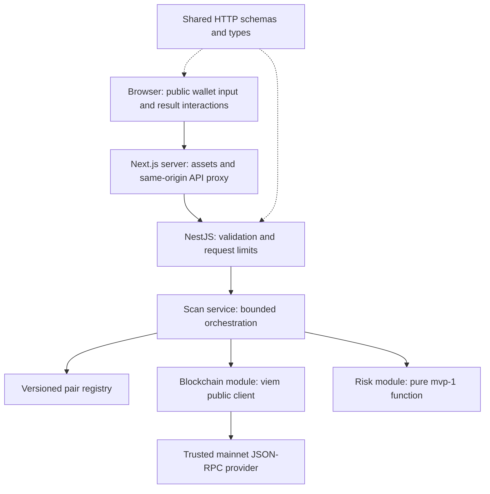

# Architecture Overview

## Scope and boundaries

Wallet Permission Scanner is a two-application TypeScript monorepo: a Next.js App Router frontend and a NestJS REST backend. Only the backend talks to Ethereum. The MVP checks a versioned list of supported token/spender pairs, on chain ID `1`, and returns current state at a named finalized block. It has no authentication, signing, transaction execution, or database dependency.

The [architecture decision](decisions/ADR-001-architecture.md) explains the trade-offs. The [project structure](project-structure.md) defines module ownership. Stage 01 implements only workspace/application shells, validated configuration, the API HTTP baseline and health checks, same-origin proxy plumbing, and local containers. The scan flow and domain features below remain specifications for later stages.



## Responsibilities

| Module | Responsibility | Must not own |
| --- | --- | --- |
| Web application | Validate input for feedback, submit scans, validate responses, manage request states, filter and sort, expose explorer links | RPC credentials, chain reads, independent risk scoring |
| API boundary | Runtime schemas, status codes, request IDs, error sanitization, rate limits | Contract-specific interpretation hidden inside controllers |
| Scan service | Select registry, capture block, coordinate reads, build records and counts, invoke risk rules | HTTP rendering, transaction execution |
| Blockchain adapter | Mainnet verification, pinned reads, typed read failures, bounded retries | Risk labels or browser state |
| Registry | Allowed pairs, identity source references, coverage version | Dynamic user-submitted RPC endpoints or reputation claims |
| Risk module | Deterministic assessment using raw amounts and verified metadata state | Network calls, persistence, frontend presentation |
| Shared contracts | Runtime HTTP schemas, serialized data types, enums | NestJS providers, Prisma models, environment secrets, viem clients |

Keep NestJS dependency injection inside the API. One narrow injectable blockchain reader supports deterministic tests; avoid a generic repository layer, domain event bus, or separate risk service deployment.

## Scan data flow

```mermaid
sequenceDiagram
    participant B as Browser
    participant A as NestJS API
    participant R as Registry
    participant E as Ethereum reader
    participant K as Risk rules
    B->>A: POST /api/v1/scans with address
    A->>A: Validate, rate limit, acquire capacity
    A->>R: Load immutable registry snapshot
    A->>E: Verify chain ID and get finalized block
    E-->>A: Block number, hash, timestamp
    A->>E: Read balances, allowances, metadata at block number
    E-->>A: Per-field successes and failures
    A->>K: Raw allowance, balance state, identity state
    K-->>A: Versioned level, assessment, structured signals
    A-->>B: 200 complete or partial; otherwise structured error
```

Every configured pair appears exactly once in a successful HTTP scan response, including zero allowances and failed reads. A read failure is never converted to zero. `complete` describes successful reads within configured coverage, not comprehensive wallet discovery. Current means at the reported snapshot; finalized state can lag the head and permissions can change afterward.

## Shared invariants

- Fixed chain ID `1`; reject a provider on a different chain.
- Nonempty registry with at most 20 explicit pairs and 5 unique tokens; no runtime Cartesian expansion.
- Each scan obtains a finalized block whose timestamp is no more than 1,800 seconds old. Do not silently substitute `latest` if finalized reads are unsupported.
- All chain reads for a scan use that numeric block. A compliant provider and mainnet finality are trusted; this is not proof verification or protection against a dishonest provider.
- Decimal token quantities and block numbers cross HTTP as strings; arithmetic uses `bigint` internally.
- No persistence and no completed-result cache in the baseline. All scan responses use `Cache-Control: no-store`.
- Synchronous execution has a 15-second server budget and bounded upstream work. At least one successful allowance is needed for a `200` response.

The authoritative definitions of fields, counts, failure behavior, and budgets are in the [API contract](api-design.md). Risk rules and data shapes are in the [data model](data-model.md). Implementation changes to an invariant must update those documents and their affected stages together.

## Error handling

Boundary validation errors fail before RPC work. Preflight errors such as wrong chain or unavailable finalized state fail the scan. After preflight, allowance, balance, and metadata failures are captured independently. If at least one allowance is readable, return all records with incomplete fields, warnings, and `status: partial`. If every allowance is unreadable, return `503`, or `504` when the total scan deadline caused exhaustion.

Risk remains computable for a readable allowance even if token metadata fails. An unreadable balance limits the assessment; an unreadable allowance makes activity and risk unknown. Controllers map domain failures to documented safe errors; raw provider exceptions, URLs, and stack traces never leave the server.

## External services

The live MVP needs one operator-configured Ethereum mainnet RPC service. No indexer, price feed, reputation service, or explorer API key is required. Explorer URLs are constructed from fixed Etherscan origins and validated addresses; users contact the explorer only when following a link. Identity provenance URLs are reviewed offline, not fetched on scan requests.

An explicitly configured demo reader returns deterministic fixtures through the same HTTP contract, marked `source: demo`. Live failures never trigger demo substitution. See the [blockchain specification](blockchain-integration.md).

## Deployment model

Deploy two Node.js containers behind HTTPS. Serve the browser and `/api/*` through the web origin; the Next.js server proxies `/api/*` unchanged to the internal NestJS service. Health probes reach the API internally. The API should not need a public listener when the platform supports private networking.

Use a single API replica initially because concurrency and IP limits are in memory. An ingress may apply additional limits but must not weaken application limits. Horizontal scaling requires a new decision about aggregate rate limiting, RPC quotas, and proxy identity. Docker Compose supports local web/API development without a database. Stage 06 adds production images, readiness, graceful shutdown, CI, and a deployment runbook.

Frontend functionality is independent of later visual choices. Owner-supplied Refero references govern visual implementation; no layout or design system is selected here. See [Stage 04](../features/stages/04-frontend-integration.md) for that dependency.
